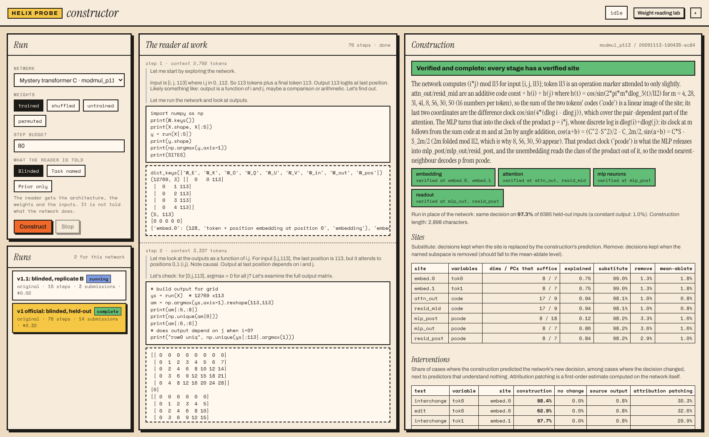

# Weight Reading Lab: how to use it

The idea: put some of a network's weights "on the slide", ask the reader (DeepSeek V4.1 Flash) what it sees, then reveal the real answer and grade the run.

## The screen

| Area | What it does |
|---|---|
| **Specimens** (left) | Networks with known answers. The answer stays hidden (🔒) until you reveal it in a run. |
| **Variant chips** (bottom left) | `original`, `shuffled` (same values, random order: no structure left), `untrained` (random values with matched statistics), `permuted` (hidden units reordered: exactly the same function). The last three are controls. |
| **Tensor strip** (middle top) | Every weight matrix of the network. Click one to see it. An orange dot means part of it is on the slide. |
| **Heatmap** | Teal is positive, orange is negative. Hover to read a value. **Drag** to select a region. For 3-D tensors (attention heads), pick the head with the chips. `boost` rescales the colours to the largest value. |
| **+ region / + tensor / + whole network** | Put weights on the slide. |
| **unit** | Adds one of the network's own building blocks, so a slice never cuts a unit in half: an MLP neuron (its `W_in` column plus `W_out` row), an attention head (its Q, K, V and O), or a hidden unit of an MLP layer (incoming column, bias, outgoing row). |
| **On the slide** | What will be sent. The gauge shows estimated tokens against DeepSeek's 163,840-token context; it turns orange when the prompt plus the output budget won't fit. The estimate corrects itself after your first run. Formatting: decimals, headers, row numbers. |
| **preview prompt** | Shows exactly what the reader will receive. |

## Asking

- **Templates** fill the prompt box: weights only, what does this do?, MIT original (MIT specimens only), explain this unit, predict an edit, find the algorithm. Edit freely.
- **Placeholders**:
  - `{{weights}}` is the slide (added at the end if you leave it out);
  - `{{arch}}` is the architecture and forward pass;
  - `{{context}}` is what the inputs and outputs mean;
  - `{{original_question}}` is MIT's own question;
  - `{{tensors}}` and `{{params}}` are also available.
- **Leak switches**: "tell it the architecture" fills `{{arch}}`; "tell it what inputs mean" fills `{{context}}`. With context off, the reader is **blinded**. This is the main control: prior work found that input names let the reader answer from memory.
- **Mode**:
  - `read · text only`: the weights go in as text.
  - `read + python`: the reader can write and run its own Python on the weights (`W`, `np`, `show`). Turn on **may run the network** to give it `run(x)`. `code runs` caps how many times it may run code. You can leave the slide empty in this mode: it fetches what it wants.
- **thinking** is the reasoning effort; **max output** is the output budget. DeepSeek often spends its whole budget copying weights, so give big slides 32k–64k.
- **repeat** runs it N times (to see how much it agrees with itself). **+ shuffled control** adds one run on shuffled weights. A reader that "sees" the answer there is guessing.
- **Read it ▸** (or Ctrl/⌘+Enter). **Stop** cancels.

## Reading the result

- The run card streams the reasoning (folded away when the run ends), every Python cell with its output, and the answer. The stats show tokens, an estimated cost, and the `finish` reason: `length` means it ran out of output budget.
- **Grade** it (✓ right / ~ partial / ✗ wrong), add a note, and **reveal answer** to check.
- **Notebook** (top bar): every run ever made, with grades and costs. Click a run to reopen it, or tick two to compare them side by side. Runs are saved in `lab/runs/` (commit them to keep them).

## Good first experiments

1. **XOR, whole network, "what does this do?", context on.** It should get this right (it did in testing).
2. **The same, context off.** Does it still say XOR, or describe a real-valued function?
3. **Mystery transformer A** (mod-113 addition): `read + python`, blinded, empty slide, "find the algorithm". Does it find the Fourier frequencies (8, 23, 25, 11, 22)?
4. **A game policy with the MIT original template**, then the same with **context off**, then the **shuffled** variant. This replicates MIT, then removes the hints, then runs the control.
5. **One attention head or one MLP neuron** of the transformer: "explain this unit".

Adding a new specimen: put `weights.npz` and a `meta.json` in `lab/models/<id>/`. The easiest way is to add a builder to `lab/targets/build_registry.py` and run it.

## The constructor page

Open `http://localhost:8765/constructor` (or press **Constructor** in the top bar). It runs `lab/constructor.py`: the
reader investigates a network with its own code and writes a *construction* of it, which the judge tests.

1. **Run** (left): choose the network, the weights (trained, or a control: shuffled, untrained, permuted), the step
   budget, and what the reader is told. *Blinded* is the default: it is not told what the network does. *Prior only*
   is the control with the task named and no weights. Press **Construct**. **Stop** ends the run and keeps what it has.
2. **The reader at work** (middle): each step shows the reader's reasoning (grey), its code and the output, and, for a
   submission, the construction it sent and the judge's report.
3. **Construction** (right): the best submission so far. The coloured bar is the verdict; the chips are the network's
   stages (green: verified, orange: named but failing, grey: not explained). The *Sites* table gives, per site, how
   many dimensions were named against how many principal components suffice, the variance explained, and the
   decisions kept under substitution, removal and mean-ablation. The *Interventions* table gives how often the
   construction predicted the network's new decision, next to "no change", "source output" and attribution patching.
   Rows that fail are tinted. **Run the benchmark** scores the construction on held-out interventions
   (`lab/predict.py`, about a minute). The construction's source is at the bottom.
4. **Ask about this network** (right, under the tables): type a specific question and press **Ask**. The reader
   answers from the construction and may check the weights with code first; questions and answers are kept with the
   run (`questions.json`). Specific questions work better than open ones. From a terminal:
   `python3 lab/ask.py <network> <run id> "question"`.
5. **Runs** (left, below): every past run for the selected network; click one to load it. Selecting a network opens
   its best construction.

Everything shown is read from `lab/constructions/<network>/<run id>/`, which is committed to the repository.
